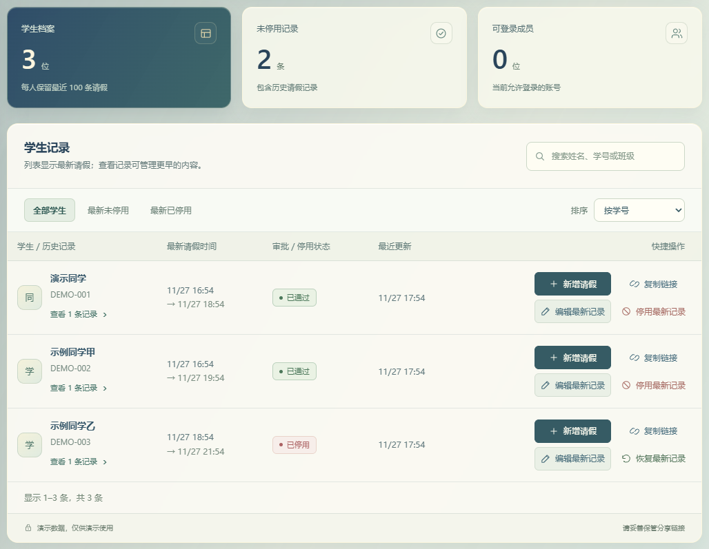
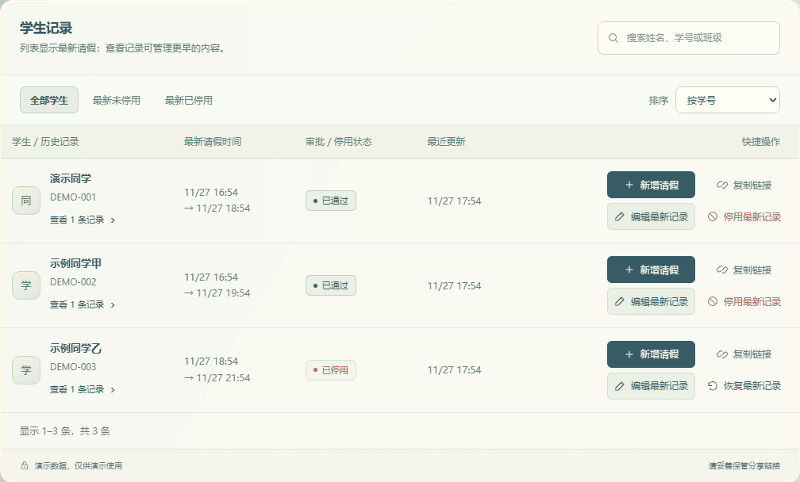

# 假条系统模板 · jiatiao-kit

一个可以自行部署的请假记录管理与分享模板。管理人员在后台填写记录，查看者通过独立链接打开手机详情。记录更新后，原链接会显示新内容；停用后即可收回访问权限。

[创建自己的仓库](https://github.com/QwQBiG/jiatiao-kit/generate) · [本地试用](#本地试用) · [前端样式配置](docs/frontend-appearance.md) · [后台管理指南](docs/admin-management.md) · [部署到 Cloudflare](docs/cloudflare.md)

## 假条展示与前端样式

首次运行即可看到彩色状态栏、条纹时间条、圆形头像和请假详情。下图是从全新模板打开的一条三小时虚构记录。附件以缩略图显示，无附件时整行隐藏。


假条和管理页有各自的样式入口。配色、布局和可选授权素材见[前端样式配置](docs/frontend-appearance.md)。

## 后台管理

学生列表展示每个人最新的一条请假。管理人员可以查看历史、生成分享链接、修改记录，或单独停用一条链接。下图使用三份虚构档案，其中一条记录已停用。



<details>
<summary>观看操作演示：切换「全部学生」「最新未停用」「最新已停用」</summary>



</details>

主管可绑定成员账号和学号、管理成员登录权限、查看操作记录。成员只能维护绑定学号的请假内容。[后台操作与权限说明](docs/admin-management.md)

## 本地试用

需要 Node.js 22.13 或更高版本。将自己的仓库下载到本机，在根目录运行：

```sh
npm start
```

按终端输出打开「演示假条」和「管理页面」。本地预览只用 Node.js 内置模块，无需云账号；每次启动都会在内存数据库中创建新的虚构记录。按 Ctrl+C 停止。[本地预览说明](docs/local-preview.md)

## 部署与验证

在项目根目录安装锁定版本的依赖，然后打开中文部署引导：

```sh
npm ci
npm run cloudflare
```

引导使用部署者自己的 Cloudflare 账号。预览与正式环境各用独立 D1 数据库；正式后台通过 Access 登录。配置完成后，按指南验证管理员访问、分享详情和数据库绑定。[Cloudflare 部署步骤](docs/cloudflare.md)

运行 `npm test` 执行完整测试。接口路径、页面脚本和分享页渲染流程见[界面接口文档](docs/ui-interfaces.md)。

## 使用范围与许可

本项目仅供学习、界面展示与测试。假条界面的视觉参考来自「今日校园」，本项目与其运营方及学校无隶属或合作关系。演示页面不能作为真实审批或通行凭证。请勿用于伪造审批、冒用身份、误导他人或披露个人信息。

项目自有代码、文档和演示图片采用 [Apache License 2.0](LICENSE)，署名见 [NOTICE](NOTICE)。第三方依赖和使用者自备的主题素材适用各自的许可。[贡献说明](CONTRIBUTING.md)
